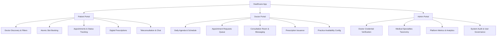

# Healthcare App
## Telemedicine & Clinic Management Platform

[](https://flutter.dev)
[](https://dart.dev)
[](https://firebase.google.com/)


An enterprise-grade cross-platform telemedicine, doctor appointment scheduling, and electronic health record (EHR) management application built with Flutter, Dart, and Firebase. Engineered with Clean Architecture, Riverpod state management, and real-time Cloud Firestore synchronization.

- **Package ID / Application ID:** `com.mudasir.healthcareapp`
- **Application Label:** `Healthcare App`
- **Target Platforms:** iOS & Android

---

## Key Capabilities & Portals

The application delivers tailored experiences across three primary user roles: **Patients**, **Doctors**, and **Administrators**.



---

### 1. Patient Portal
- **Specialist Discovery & Advanced Search:** Filter licensed physicians by medical specialty, patient satisfaction ratings, consultation fees, and keywords with real-time feedback and shimmer loading states.
- **Doctor Profiles & Credentials:** View physician biographies, qualifications, clinic room locations, years of clinical experience, patient reviews, and accepted insurances.
- **Conflict-Free Appointment Booking:** Interactive date and time slot selector backed by atomic database transaction locks that eliminate double-booking race conditions.
- **Lifecycle Appointment Tracking:** Track upcoming, past, confirmed, in-progress, and cancelled consultations with clear visual status indicators and countdown timers.
- **Teleconsultation Suite:** In-app encrypted video consultation interface with active call duration counters and media controls (camera, microphone toggle).
- **Real-Time Appointment Messaging:** Secure in-consultation chat with read receipts, delivery timestamps, and doctor clinical responses.
- **Digital Prescription Wallet:** Instant access to digital medical prescriptions detailing diagnosis, prescribed medications, dosage schedules, intake instructions, and authorized refills.
- **Personal Health Profile:** Emergency contact details, blood group, allergies, and historical appointment log.

---

### 2. Doctor Portal
- **Clinical Agenda & Schedule:** Chronological daily consultation agenda with quick patient triage indicators (`Confirmed`, `In-Progress`, `Completed`).
- **Consultation Requests Queue:** Review incoming appointment bookings from patients with one-tap approval or rejection, complete with clinical reason tracking.
- **Telemedicine Consultation Desk:** High-fidelity video call interface and synchronous messaging stream to conduct remote patient visits.
- **Digital Prescription Builder:** Integrated prescription creation module to specify patient diagnosis, medication details (name, dosage, frequency, duration, dietary instructions), and dispensing refills.
- **Clinical Notes & Records:** Review past visit notes, diagnostic outcomes, and prescribed treatment regimens.
- **Schedule & Availability Setup:** Set working days, consultation hours, and slot intervals for automated patient booking.

---

### 3. Administrator Portal
- **Doctor Verification & Credentialing:** Verification desk for incoming medical practitioners. Review medical licenses, credentials, and verification status (`Pending`, `Approved`, `Rejected`).
- **Medical Taxonomy & Specialty Management:** Manage hospital departments, clinical specialties, diagnostic categories, and associated UI icons.
- **Platform Analytics & Health Metrics:** High-level dashboard displaying active doctors, booked consultations, completed patient visits, and revenue metrics.
- **System Governance & Security:** Enforce platform-wide role-based access control (RBAC) and audit log integrity.

---

## Technical Architecture & Engineering Highlights

### 1. Clean Architecture & Feature-First Structure
The codebase follows Clean Architecture with Feature-First packaging, isolating presentation, domain, and data layers:

```
lib/
├── app.dart                   # Root MaterialApp, routing configuration, global themes
├── main.dart                  # Application entry point & service initialization
├── core/                      # Shared infrastructure & cross-cutting concerns
│   ├── errors/                # Structured AppException hierarchy & failure handlers
│   ├── network/               # Connectivity monitors & network state providers
│   ├── providers/             # Global Riverpod state providers & dependency injection
│   ├── routing/               # Declarative GoRouter configuration & route guards
│   ├── services/              # Firebase, Auth, and Presence services
│   ├── theme/                 # Modern healthcare color tokens, typography & styling
│   ├── utils/                 # DateTime formatting, ISO-8601 UTC & timezone normalizers
│   └── widgets/               # Reusable atomic UI components (AppDialog, StatusBadge, etc.)
└── features/
    ├── admin/                 # Admin dashboard, doctor verification desk, taxonomy manager
    ├── appointment/           # Domain models, repositories, state machine, booking logic
    ├── auth/                  # Authentication, role-based dispatching, sign-in & sign-up
    ├── consultation/          # Video consultation room, real-time chat, digital prescriptions
    ├── doctor/                # Doctor agenda, request queue approval, clinical profile
    └── patient/               # Doctor search, slot selector, appointment history, Rx viewer
```

---

### 2. Atomic Concurrency Protection (Zero Double-Bookings)
To prevent race conditions when multiple patients attempt to book the same physician slot simultaneously:
- Each consultation claims a deterministic reservation key: `slots/{doctorId}_{yyyyMMddTHHmm}` (e.g., `doc_aisha_20261103T1000`).
- Writes are committed via atomic transactions. The first write claims ownership; colliding attempts instantly trigger a `SlotAlreadyBookedException`, cleanly redirecting the second patient to select an alternative slot.

---

### 3. Strict Lifecycle State Machine
Appointment progressions adhere to a formal state machine (`AppointmentStateMachine`) with strictly validated forward transitions:

$$\text{Requested} \longrightarrow \begin{cases} \text{Confirmed} & \text{(Doctor approves)} \\ \text{Rejected} & \text{(Doctor declines)} \\ \text{Cancelled} & \text{(Patient cancels)} \end{cases}$$

$$\text{Confirmed} \longrightarrow \begin{cases} \text{InProgress} & \text{(Consultation begins)} \\ \text{Cancelled} & \text{(Doctor / Patient cancels)} \end{cases}$$

$$\text{InProgress} \longrightarrow \text{Completed} \quad \text{(Doctor finalizes \& issues Rx)}$$

- **Cancellation Policy:** Patient cancellations are programmatically barred if the consultation is scheduled within 2 hours, safeguarding physician schedules against last-minute dropouts.

---

### 4. Timezone Normalization & Cross-Region Support
- **Persistence:** All timestamps are normalized to strict ISO-8601 UTC (`toUtc().toIso8601String()`) before cloud persistence.
- **Rendering:** The presentation layer dynamically converts UTC timestamps into the user's localized timezone, displaying explicit zone abbreviations (e.g., `Nov 3, 2026 • 10:00 AM (EST)`).

---

### 5. Cloud Firestore Security Rules
Production-grade security rules enforce document-level and field-level permissions:
- **Authentication Guard:** Every read/write requires valid session authentication.
- **Privacy Enforcement:** Consultation records, chat messages, and prescriptions are strictly scoped to the participating patient, treating doctor, or platform administrators.
- **Role Verification:** Critical actions (approving doctors, editing taxonomy) require authenticated `admin` claims or Firestore user role verification.

---

## Getting Started

### Prerequisites
- **Flutter SDK:** Version 3.13.0 or higher
- **Dart SDK:** Version 3.13.0 or higher
- **Android Studio** / **Xcode** (for device builds and deployment)
- **Firebase Account** with a configured project

---

### Installation & Setup

1. **Clone the Repository:**
   ```bash
   git clone https://github.com/your-username/healthcare-app.git
   cd healthcare-app
   ```

2. **Install Dependencies:**
   ```bash
   flutter pub get
   ```

3. **Configure Firebase:**
   - Add your `google-services.json` to `android/app/`
   - Add your `GoogleService-Info.plist` to `ios/Runner/`
   - Ensure Cloud Firestore and Firebase Authentication (Email/Password) are enabled in your Firebase console.

4. **Verify Static Analysis:**
   ```bash
   flutter analyze
   ```
   *(Expected result: No issues found!)*

5. **Run Automated Test Suite:**
   ```bash
   flutter test
   ```
   *(Expected result: 31 tests passed!)*

6. **Launch the Application:**
   ```bash
   flutter run
   ```

---

## Automated Test Coverage

The test suite validates critical business logic, security boundaries, and domain rules:

```bash
00:01 +31: All tests passed!
```

- **Concurrency & Slot Locking:** Atomic key generation, duplicate reservation collision rejection, and multi-user race conditions.
- **State Machine Integrity:** Legal progression verification, illegal state transition prevention, and terminal state immutability.
- **Timezone Calculations:** UTC conversion round-trips, local string rendering, and slot key determinism.
- **Cancellation Business Logic:** Enforcing the 2-hour cancellation lockout window.
- **Doctor Search & Filtering:** Verification status indexing, specialty filtering, rating bounds, fee caps, and multi-term search.
- **Prescription & Chat Protocols:** Prescription payload integrity, medication schedule validation, and chronological messaging.
- **UI & Widget Component Testing:** Status badge pill styling, empty state recovery actions, error retry mechanics, and offline banners.

---

## Security & Data Privacy

- **Transport Security:** All communications use TLS 1.3 / HTTPS encryption.
- **Role-Based Access Control (RBAC):** Token-level role propagation guarantees patients, doctors, and admins cannot access unauthorized endpoints or documents.
- **Session Protection:** Automatic session validation and state synchronization with Firebase Authentication.
- **PHI (Protected Health Information):** Medical prescriptions and consultation transcripts are strictly isolated to authenticated participants.

---

## License

This project is licensed under the MIT License — see the [LICENSE](LICENSE) file for details.
